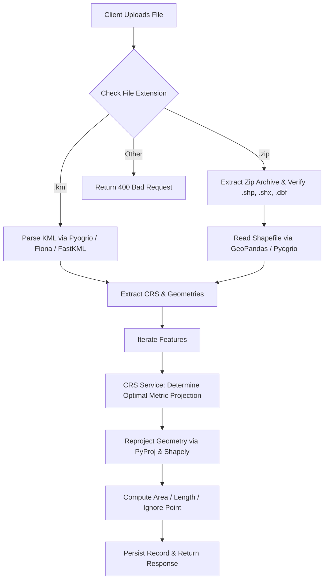

# Geospatial File Measurement API 🌍📐

A production-ready backend service built with **FastAPI**, **GeoPandas**, **PyProj**, and **Shapely** that ingests geospatial files (ESRI Shapefiles and Google Earth KML), extracts their geometric features, reprojects geographic coordinates into optimal metric projected coordinate systems, and accurately computes geometric measurements (Area for Polygons, Length for LineStrings).

---

## 📑 Table of Contents
- [Key Features](#-key-features)
- [Architecture & Design](#-architecture--design)
  - [Application Structure](#application-structure)
  - [File Processing Flow](#file-processing-flow)
  - [Measurement Calculation Flow](#measurement-calculation-flow)
  - [CRS Handling Strategy](#crs-handling-strategy)
- [Design Decisions & Alternatives](#-design-decisions--alternatives)
- [API Documentation](#-api-documentation)
  - [Endpoints Overview](#endpoints-overview)
  - [Example Requests & Responses](#example-requests--responses)
- [Local Setup & Installation](#-local-setup--installation)
  - [Prerequisites](#prerequisites)
  - [Step-by-Step Run Instructions](#step-by-step-run-instructions)
  - [Running Tests](#running-tests)
- [Interactive Web UI](#-interactive-web-ui)
- [Learnings](#-learnings)
- [Future Scope & Production Roadmap](#-future-scope--production-roadmap)

---

## 🚀 Key Features

- **Multi-Format Ingestion**: Supports `.kml` and `.zip` archives containing ESRI Shapefile sets (`.shp`, `.shx`, `.dbf`, `.prj`), including nested directories and Zip-Slip protection.
- **Dynamic Projected CRS Transformation**: Automatically detects geographic coordinates (such as `EPSG:4326` degrees) and projects geometries to the local **UTM zone** (in meters) before calculating measurements, preventing distortion errors.
- **Metric Geometric Measurements**:
  - **Polygon / MultiPolygon**: Area in square meters ($m^2$), hectares ($ha$), square kilometers ($km^2$), and acres.
  - **LineString / MultiLineString**: Length in meters ($m$), kilometers ($km$), and miles.
  - **Point / MultiPoint**: Gracefully handled without measurement (status `not_applicable`).
- **Resilient Error Handling**: Gracefully handles corrupt archives, missing `.prj` projection files, empty geometries, and unsupported types without crashing.
- **Interactive UI Dashboard**: Modern browser interface at `/` for drag-and-drop file testing, viewing measurement tables, and copying JSON output.
- **Interactive API Docs**: Automatic Swagger UI (`/docs`) and ReDoc (`/redoc`).

---

## 🏗️ Architecture & Design

### Application Structure

```text
AUS/
├── app/
│   ├── api/
│   │   ├── __init__.py
│   │   └── routes.py           # FastAPI endpoints (upload, info, measurements, features)
│   ├── core/
│   │   ├── __init__.py
│   │   ├── config.py           # Application settings, paths, limits
│   │   └── exceptions.py       # Domain-specific exception hierarchy
│   ├── models/
│   │   ├── __init__.py
│   │   └── schemas.py          # Pydantic v2 validation models & schemas
│   ├── services/
│   │   ├── __init__.py
│   │   ├── crs_service.py      # CRS inspection, UTM determination & reprojection
│   │   ├── measurement.py      # Metric measurement engine & unit conversions
│   │   ├── parser.py           # Shapefile ZIP and KML extractor
│   │   └── storage.py          # Thread-safe metadata & state persistence
│   ├── static/
│   │   └── index.html          # Interactive web UI dashboard
│   ├── __init__.py
│   └── main.py                 # FastAPI application factory & middleware
├── storage/
│   ├── uploads/                # Stored raw uploaded files
│   └── db/                     # Thread-safe JSON record store
├── tests/
│   ├── sample_data/            # Sample KML, Shapefile zip, and LineString zip
│   ├── generate_samples.py     # Script to generate sample geospatial files
│   ├── test_api.py             # End-to-end API test suite
│   ├── test_crs.py             # CRS and UTM projection tests
│   └── test_measurements.py    # Area, length, and point handling tests
├── requirements.txt            # Python dependencies
├── .gitignore                  # Git ignore rules
└── README.md                   # Comprehensive documentation
```

### File Processing Flow



1. **Upload & Sanity Check**: Validates the file extension (`.zip` or `.kml`) and enforces maximum upload size (50MB).
2. **Decompression & Security Check**: For `.zip` files, extracts safely into an isolated temporary folder, verifying path containment against directory traversal vulnerabilities (Zip-Slip).
3. **GeoDataFrame Ingestion**:
   - Shapefiles are loaded using `pyogrio` engine via GeoPandas.
   - KML files are read via `pyogrio` native GDAL driver with fallbacks to `fiona` and `fastkml`.
4. **Feature Normalization**: Iterates through records, extracting geometry types, GeoJSON representations, attribute dictionaries (sanitizing NaNs and timestamps), and CRS metadata.

### Measurement Calculation Flow

1. For each feature, inspect the geometry type:
   - **Point / MultiPoint**: Flagged as `not_applicable`, returning `value: null`.
   - **Polygon / MultiPolygon**: Dispatched to `_calculate_area()`.
   - **LineString / MultiLineString**: Dispatched to `_calculate_length()`.
   - **Empty Geometries / GeometryCollection**: Handled gracefully with explanatory status notes.
2. Coordinates are reprojected using `pyproj.Transformer` with `always_xy=True`.
3. Planar area ($m^2$) or planar length ($m$) is computed on the transformed Shapely geometry.
4. Secondary metric and imperial units (hectares, $km^2$, acres, kilometers, miles) and formatted text representations are generated.

### CRS Handling Strategy

Calculating area or distance directly on angular coordinates (such as degrees in `EPSG:4326`) produces mathematically invalid values because a degree of longitude varies significantly depending on latitude (from ~111 km at the equator to 0 at the poles).

#### Reprojection Algorithm:
1. **Check Source Coordinate System**:
   - If the source file already uses a projected planar coordinate system whose unit is meters (e.g., State Plane, national grid), we use that CRS directly.
   - If the source coordinate system is geographic (angular units in degrees, e.g., `EPSG:4326` WGS 84), we determine the feature's centroid $(lon, lat)$.
2. **Calculate Optimal UTM Zone**:
   $$\text{Zone Number} = \left\lfloor \frac{lon + 180}{6} \right\rfloor + 1$$
   $$\text{EPSG Code} = \begin{cases} 32600 + \text{Zone Number} & \text{if } lat \ge 0 \text{ (Northern Hemisphere)} \\ 32700 + \text{Zone Number} & \text{if } lat < 0 \text{ (Southern Hemisphere)} \end{cases}$$
3. **Polar & Extreme Boundary Fallback**:
   - For polar regions ($|lat| > 80^\circ$) where standard UTM is distorted or undefined, the service automatically falls back to **World Cylindrical Equal Area (`EPSG:6933`)** or Universal Polar Stereographic.
4. **Valid Topology Enforcement**:
   - Reprojection is performed using vectorized `shapely.transform()`.
   - Any topological invalidities introduced by floating-point transformation are automatically repaired using `shapely.make_valid()`.

---

## 💡 Design Decisions & Alternatives

| Decision | Selected Choice | Alternatives Considered | Rationale |
| :--- | :--- | :--- | :--- |
| **Framework** | **FastAPI** | Django + DRF, Flask | FastAPI provides automatic OpenAPI/Swagger interactive docs, native async I/O, fast startup time, strict Pydantic v2 schemas, and lightweight footprint. |
| **Geospatial Engine** | **GeoPandas + Pyogrio + Shapely + PyProj** | Custom GDAL C-bindings, ArcPy | Standard open-source geospatial stack in Python. Pyogrio offers 5-10x faster I/O than pure Python parsers and natively supports both ESRI Shapefile and KML drivers. |
| **Projection Strategy** | **Dynamic UTM Zone per centroid** | Web Mercator (EPSG:3857), Global Equal Area | Web Mercator distorts area significantly as latitude increases (Greenland appears the size of Africa). UTM provides low distortion (<0.1%) within its zone, making it ideal for cadastral and survey measurements. |
| **Persistence** | **Disk-Backed JSON Record Store** | PostgreSQL + PostGIS, SQLite | Eliminates external database setup dependencies for running and evaluating the application locally, while maintaining thread safety with file locks. |
| **Client Interface** | **Embedded Dashboard + Swagger** | Headless API only | Provides immediate visual feedback, allowing anyone to drag-and-drop test files without needing Postman or cURL. |

---

## 📖 API Documentation

### Endpoints Overview

| Method | Endpoint | Description |
| :--- | :--- | :--- |
| `POST` | `/api/files/` | Upload and process `.zip` (Shapefile) or `.kml` |
| `GET` | `/api/files/{id}/` | Get uploaded file information & status |
| `GET` | `/api/files/{id}/measurements/` | Get geometric measurements for all features |
| `GET` | `/api/files/{id}/features/` | Get full GeoJSON FeatureCollection |
| `GET` | `/api/files/` | List all processed files |
| `DELETE` | `/api/files/{id}/` | Delete a file and its measurements |
| `GET` | `/api/health` | Health check and supported format verification |

---

### Example Requests & Responses

#### 1. Upload File (`POST /api/files/`)

```bash
curl -X POST "http://127.0.0.1:8000/api/files/" \
  -H "accept: application/json" \
  -H "Content-Type: multipart/form-data" \
  -F "file=@tests/sample_data/survey.kml"
```

**Response (`201 Created`):**
```json
{
  "id": "e6a2185c1387",
  "filename": "survey.kml",
  "feature_count": 3,
  "crs": "EPSG:4326",
  "status": "COMPLETED",
  "message": "File uploaded and processed successfully"
}
```

#### 2. Get File Information (`GET /api/files/{id}/`)

```bash
curl -X GET "http://127.0.0.1:8000/api/files/e6a2185c1387/"
```

**Response (`200 OK`):**
```json
{
  "id": "e6a2185c1387",
  "filename": "survey.kml",
  "feature_count": 3,
  "crs": "EPSG:4326",
  "status": "COMPLETED",
  "file_type": "kml",
  "file_size_bytes": 1420,
  "created_at": "2026-10-11T14:15:30.123456+00:00",
  "error_message": null
}
```

#### 3. Get Measurements (`GET /api/files/{id}/measurements/`)

```bash
curl -X GET "http://127.0.0.1:8000/api/files/e6a2185c1387/measurements/"
```

**Response (`200 OK`):**
```json
{
  "id": "e6a2185c1387",
  "filename": "survey.kml",
  "feature_count": 3,
  "crs": "EPSG:4326",
  "status": "COMPLETED",
  "summary": {
    "total_features": 3,
    "polygon_count": 1,
    "linestring_count": 1,
    "point_count": 1,
    "other_count": 0,
    "total_area_sq_meters": 305178.4512,
    "total_area_hectares": 30.5178,
    "total_length_meters": 1342.1580,
    "total_length_km": 1.3422
  },
  "measurements": [
    {
      "feature_id": 0,
      "geometry_type": "Polygon",
      "properties": {
        "name": "Agricultural Field 101",
        "description": "Rice cultivation parcel"
      },
      "measurement": {
        "type": "area",
        "value": 305178.4512,
        "unit": "square_meters",
        "formatted": "30.52 ha (305,178.5 m²)",
        "additional_units": {
          "hectares": 30.5178,
          "square_kilometers": 0.305178,
          "acres": 75.4111
        },
        "projected_crs": "EPSG:32643 (WGS 84 / UTM Zone 43N)",
        "status": "calculated",
        "note": "Calculated using planar projection in metric UTM coordinate system."
      }
    },
    {
      "feature_id": 1,
      "geometry_type": "LineString",
      "properties": {
        "name": "Survey Access Road",
        "description": "Secondary access corridor"
      },
      "measurement": {
        "type": "length",
        "value": 1342.158,
        "unit": "meters",
        "formatted": "1.34 km (1,342.2 m)",
        "additional_units": {
          "kilometers": 1.3422,
          "miles": 0.834
        },
        "projected_crs": "EPSG:32643 (WGS 84 / UTM Zone 43N)",
        "status": "calculated",
        "note": "Calculated using planar projection in metric UTM coordinate system."
      }
    },
    {
      "feature_id": 2,
      "geometry_type": "Point",
      "properties": {
        "name": "Station Alpha",
        "description": "Weather and IoT monitoring beacon"
      },
      "measurement": {
        "type": "not_applicable",
        "value": null,
        "unit": null,
        "formatted": null,
        "additional_units": {},
        "projected_crs": null,
        "status": "not_applicable",
        "note": "Point geometries have zero area and length by definition."
      }
    }
  ]
}
```

---

## 🛠️ Local Setup & Installation

### Prerequisites
- Python 3.10+ (Tested on Python 3.11, 3.12, 3.13)
- `git`

### Step-by-Step Run Instructions

1. **Clone the repository:**
   ```bash
   git clone https://github.com/manasagururaj/geospatial-measurement-api.git
   cd geospatial-measurement-api
   ```

2. **Create and activate a virtual environment:**
   ```bash
   # Windows (PowerShell)
   python -m venv .venv
   .venv\Scripts\Activate.ps1

   # Linux / macOS
   python3 -m venv .venv
   source .venv/bin/activate
   ```

3. **Install dependencies:**
   ```bash
   pip install -r requirements.txt
   ```

4. **Generate sample datasets (Optional):**
   ```bash
   python tests/generate_samples.py
   ```
   *Generates `survey.kml`, `parcels.zip`, and `routes.zip` in `tests/sample_data/`.*

5. **Start the API server:**
   ```bash
   uvicorn app.main:app --host 127.0.0.1 --port 8000 --reload
   ```

6. **Access the application:**
   - 🌐 **Interactive Web UI**: [http://127.0.0.1:8000](http://127.0.0.1:8000)
   - ⚡ **Interactive Swagger Docs**: [http://127.0.0.1:8000/docs](http://127.0.0.1:8000/docs)
   - 📖 **ReDoc Documentation**: [http://127.0.0.1:8000/redoc](http://127.0.0.1:8000/redoc)

---

### Running Tests

Run the test suite using `pytest`:

```bash
pytest -v
```

Expected output:
```text
tests/test_api.py::test_health_check PASSED                              [  6%]
tests/test_api.py::test_upload_kml_file PASSED                           [ 12%]
tests/test_api.py::test_upload_shapefile_zip PASSED                      [ 18%]
tests/test_api.py::test_upload_invalid_file_extension PASSED             [ 25%]
tests/test_api.py::test_get_nonexistent_file PASSED                      [ 31%]
tests/test_api.py::test_delete_file PASSED                               [ 37%]
tests/test_crs.py::test_normalize_crs_standard PASSED                    [ 43%]
tests/test_crs.py::test_normalize_crs_fallback PASSED                    [ 50%]
tests/test_crs.py::test_is_geographic PASSED                             [ 56%]
tests/test_crs.py::test_utm_zone_selection_bangalore PASSED              [ 62%]
tests/test_crs.py::test_utm_zone_selection_newyork PASSED                [ 68%]
tests/test_crs.py::test_reproject_geometry PASSED                        [ 75%]
tests/test_measurements.py::test_polygon_area_calculation PASSED         [ 81%]
tests/test_measurements.py::test_linestring_length_calculation PASSED    [ 87%]
tests/test_measurements.py::test_point_graceful_handling PASSED          [ 93%]
tests/test_measurements.py::test_empty_geometry_graceful_handling PASSED [100%]

======================== 16 passed in 1.50s ========================
```

---

## 🖥️ Interactive Web UI

The service includes a built-in web dashboard at `http://127.0.0.1:8000`:
- **Drag & Drop Upload**: Test `.kml` and `.zip` files directly from your browser.
- **Real-Time Projection Feedback**: Displays the identified source CRS and target UTM projection.
- **Detailed Measurement Breakdown**: Displays Area ($m^2$, $ha$, $km^2$) for Polygons, Length ($m$, $km$) for Lines, and indicates Point geometries.
- **Export & Inspect**: Inspect raw GeoJSON feature payloads and copy response JSON with one click.

---

## 🧠 Learnings

1. **Geodetic vs. Projected Geometries**:
   - Geometries with geographic coordinates (`EPSG:4326`) store angles (degrees), not planar distances. Computing area or Euclidean distance directly on degrees produces misleading, latitude-dependent inaccuracies.
   - Dynamic per-feature UTM zone projection provides a robust, standardized planar metric coordinate system with minimal scale distortion for localized measurements.
2. **KML Engine Divergence**:
   - Different GDAL/GEOS builds support KML differently depending on whether `LIBKML` or `pyogrio` is available. Providing a multi-tier fallback parser (`pyogrio` -> `fiona` -> `fastkml`) ensures cross-platform reliability on Windows, Linux, and macOS.
3. **Data Serialization Sanitization**:
   - Real-world geospatial files frequently contain `NaN`, `inf`, numpy data types (`int64`, `float64`), or pandas timestamps in their attribute tables. Implementing an attribute sanitizer before Pydantic serialization prevents runtime 500 crashes.
4. **Zip-Slip Vulnerability Prevention**:
   - Uploaded zip archives can contain malicious paths like `../../etc/passwd`. Verifying path resolution within temporary directories prevents directory traversal attacks during extraction.

---

## 🔮 Future Scope & Production Roadmap

1. **Asynchronous Background Processing for Large Datasets (Celery / Redis / ARQ)**:
   - For multi-gigabyte files with hundreds of thousands of polygons (e.g., nationwide parcel datasets), convert processing to background tasks with job status polling or WebSocket updates (`status: PROCESSING -> COMPLETED`).
2. **PostGIS Database Integration**:
   - Replace disk-backed JSON persistence with PostgreSQL + PostGIS, enabling spatial indexing (`GiST`), spatial SQL queries (`ST_Area`, `ST_Length`), and spatial filtering (bounding box, intersection queries).
3. **Multi-Format Ingestion**:
   - Expand supported input formats to **GeoJSON**, **GeoPackage (`.gpkg`)**, **FlatGeobuf (`.fgb`)**, and **DXF/CAD**.
4. **Geodesic Calculation Toggle**:
   - Offer an optional API parameter `calculation_method="projected_utm" | "geodesic_karney"` allowing users to select Karney's geodesic ellipsoidal algorithm via `pyproj.Geod` alongside planar UTM.
5. **Interactive Map Visualization**:
   - Integrate a Leaflet / MapLibre GL viewer in the frontend to display rendered polygons and lines directly on a satellite basemap.
6. **Containerization & CI/CD**:
   - Add a multi-stage `Dockerfile` and GitHub Actions workflow for automated testing, linting, and container deployment.

---

## 👤 Author
- **Repository**: [https://github.com/manasagururaj/geospatial-measurement-api](https://github.com/manasagururaj/geospatial-measurement-api)
- **License**: MIT
